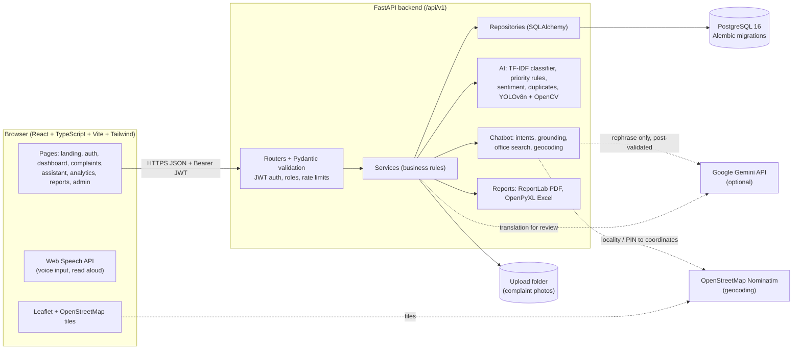
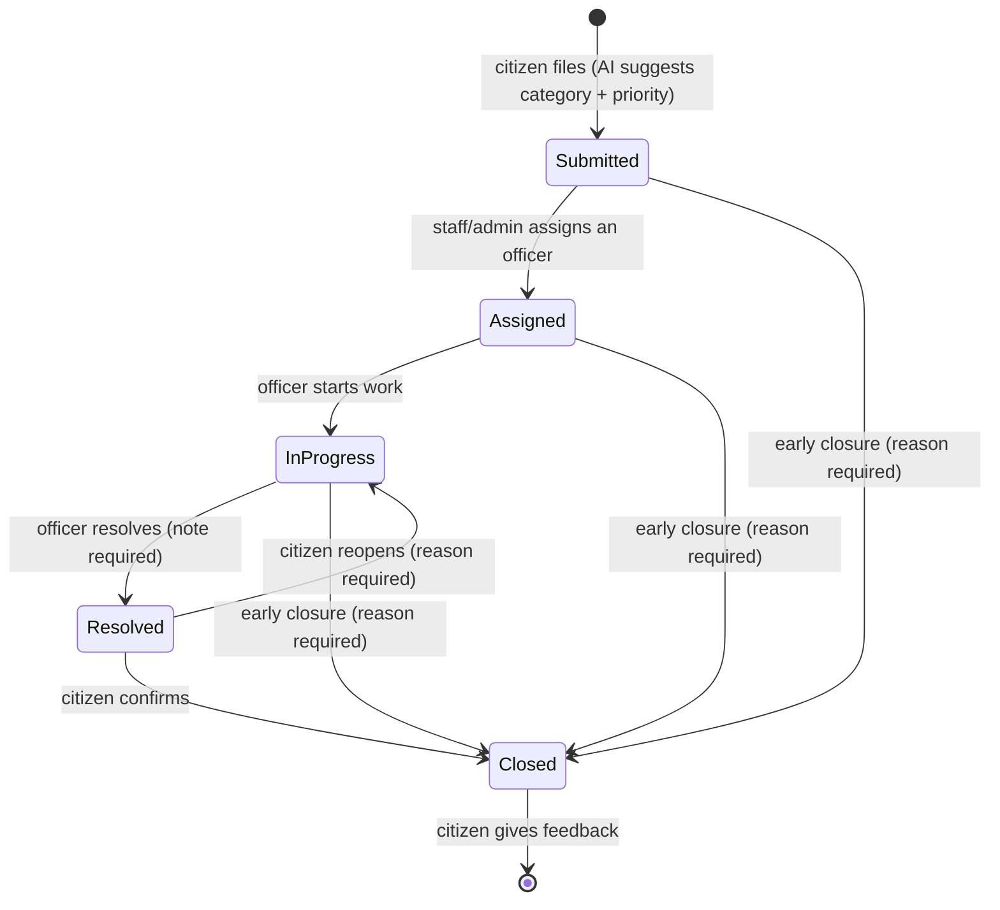
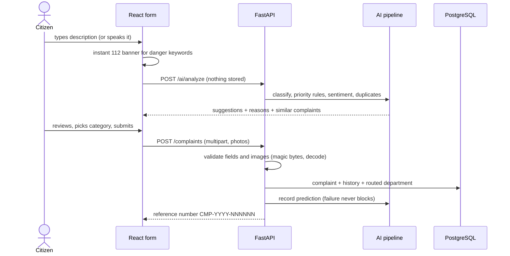

# Architecture

## System overview



## Complaint lifecycle



## Filing a complaint (request flow)



## Module map

```
React (Vite, TS, Tailwind)  ──HTTPS / JSON + JWT──▶  FastAPI (/api/v1)
  pages · layouts · services                          ├─ api/          routers (one per module)
  Leaflet map · Recharts                              ├─ services/     business logic
                                                      ├─ repositories/ SQLAlchemy queries
                                                      ├─ ai/           classifier, priority, sentiment,
                                                      │                duplicates, YOLOv8
                                                      ├─ chatbot/      Gemini + grounding layer
                                                      ├─ location/     geocoding, office search, distance
                                                      └─ reports/      ReportLab (PDF), OpenPyXL (Excel)
                                                              │
                                                     PostgreSQL 16 (Alembic migrations)
```

## Layering rules

- Routers validate input (Pydantic) and enforce authorization; they contain no SQL.
- Services hold business rules and call repositories and AI components.
- Repositories are the only layer that queries the database.
- AI components are pure Python and testable without the web layer.

## Decisions

- **Database:** PostgreSQL 16 installed natively, because Docker Desktop's engine would not start on the
  development machine. `docker-compose.yml` is kept for environments where Docker works.
- **Training data:** synthetic, self-authored labelled complaint dataset (documented as such).
  All reported metrics come from a held-out test split.
- **Authentication:** Argon2id password hashing (pwdlib). JWT access tokens (30 min) and rotating refresh
  tokens (7 days), each with a unique ID (`jti`). Logout and refresh rotation store revoked IDs in
  `revoked_tokens`. Changing or resetting a password sets `password_changed_at`, which invalidates every
  token issued earlier. Disabled accounts are rejected on every request, not only at login.
- **Token storage (frontend):** localStorage, chosen for simplicity across separate frontend/backend
  origins. Mitigations: short access-token lifetime, single-use refresh tokens, server-side revocation.
- **Password reset:** random 256-bit token, only its SHA-256 hash stored, 30-minute expiry, single use,
  previous tokens invalidated on a new request; identical response for unknown emails.
- **Rate limiting:** in-memory sliding window per client IP on auth endpoints (single-instance scope).
- **Departments and categories:** 12 categories seeded by migration, each mapped to an internal routing
  department (generic names, not claims about specific real offices). Complaints record the department at
  submission time, so later mapping changes do not silently re-route existing complaints.
- **Complaint privacy:** non-owners get `404` (not `403`) so complaint IDs and references cannot be probed.
- **Office data:** Hyderabad only. Each office record stores its source URL and verification date.
  The chatbot never shows contact details that are not in the database.
- **Complaint assistant (module 8):** stateless `POST /chatbot/message` (client sends the conversation).
  Keyword category detection (English/Hinglish/Telugu, swappable via `chatbot.categories.set_detector`),
  verified `offices` table (categories as a JSONB list of slugs; `"*"` = all), haversine distance only when
  both points have coordinates, OSM/Google directions links with the destination only. Typed localities and
  PIN codes are geocoded with Nominatim (1 req/s, cached, Hyderabad bounding box); device location is used
  only after the browser permission prompt; never inferred from IP. Optional Gemini only rephrases the template
  reply and is discarded if it mentions any phone, URL or email not in the retrieved records. Sources:
  `docs/office_data_sources.md`. Category detection is hybrid: keyword rules first (explainable, multilingual),
  then the module-5 classifier when it is at least 50% confident.
- **Staff roles (module 4):** `can_manage(complaint, user)` is the single permission check: admins manage
  everything, staff only complaints routed to their own department. Dashboards and reports use the same scope.
- **AI predictions (module 5):** stored per complaint with model version; `complaints.priority_source`
  distinguishes AI-predicted from staff-set priority. Emergency guidance comes from keyword rules and is shown
  immediately, independent of any model.
- **Image analysis (module 9):** YOLOv8n (COCO, 80 everyday object classes) plus OpenCV quality checks. It
  cannot detect potholes or garbage; results are hints only and never applied automatically.
- **Feedback and AI review (module 11):** one rating per resolved complaint. Admins review predictions that
  people disagreed with. Reviews are recorded only; nothing retrains automatically. Corrections can be
  exported as CSV for a deliberate retraining run (`python -m app.ai.train` after adding labelled data).
